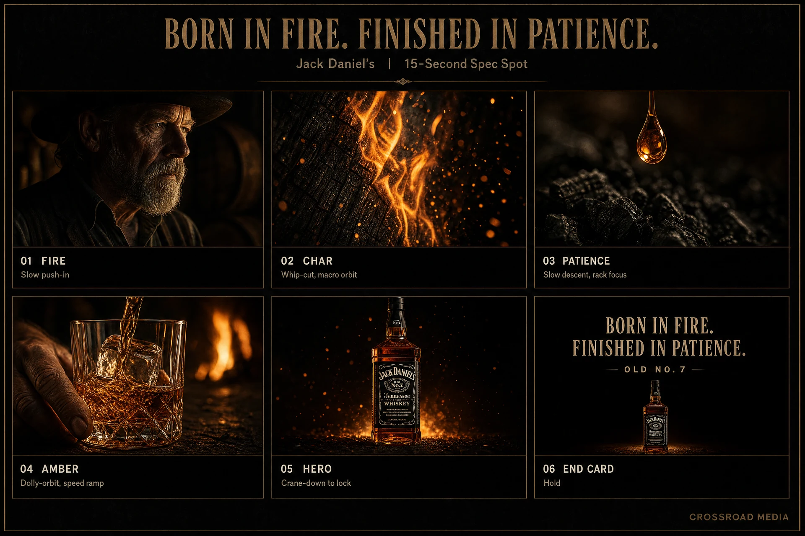
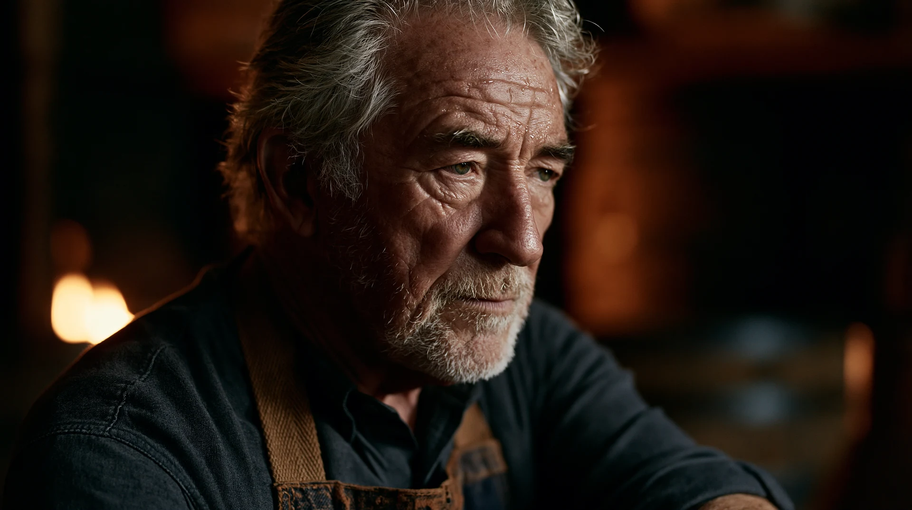
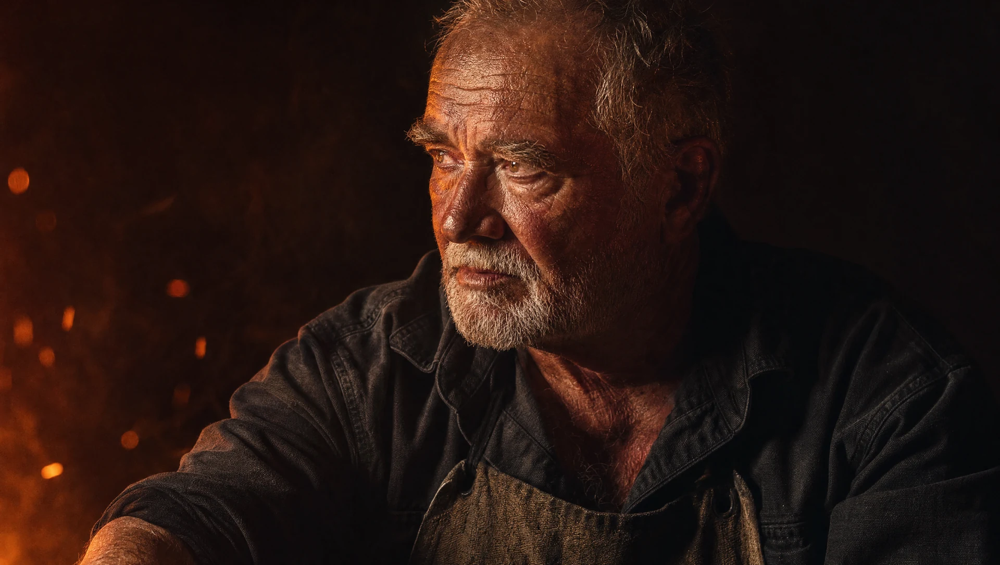
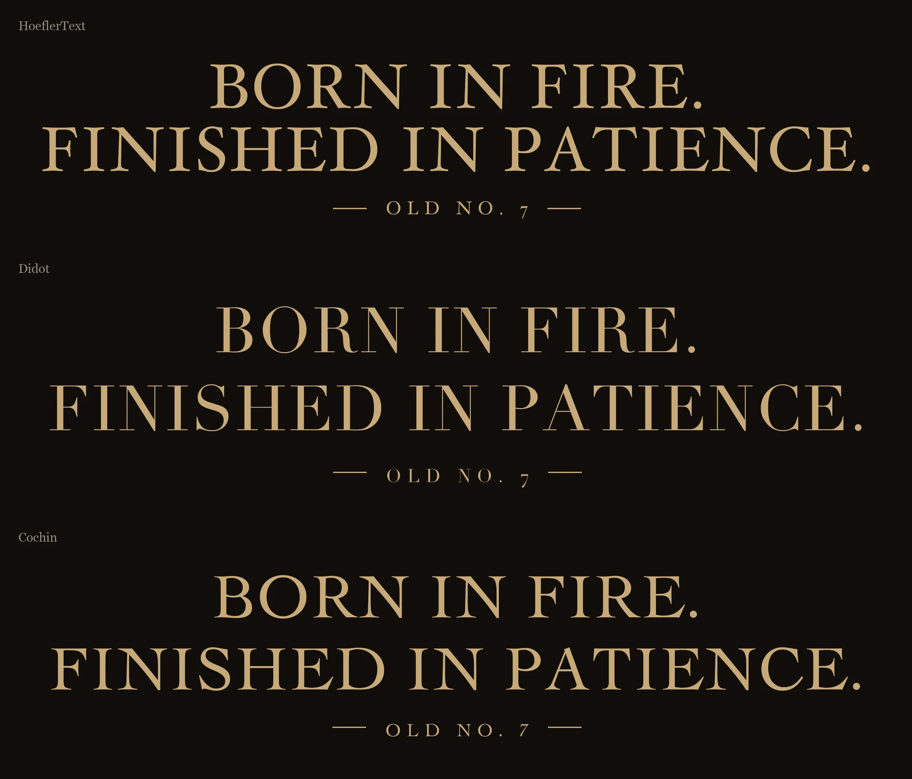

# 《Born From Fire》：零基础 AI 视频学习手册

你现在要学会的第一件事，是看懂：一支片子的想法，怎样一步步变成图片、运动和剪辑。先读这份图解；需要复查细节时，再打开完整提示词。

本资料依据你下载的原包整理。原作与素材作者为 **Calixte LeBlanc／Crossroad Media**。译文是对原文件的完整中文说明；“新手解读”和“练习”由本次整理补充。

## 01 先知道这支片子在表达什么

这是按“15 秒广告”目标制作的威士忌自主广告样片。本次下载到的公开成片文件实测约 **19.53 秒**（1080p、24fps），制作目标和公开视频总时长要分开看。广告语 **BORN IN FIRE. FINISHED IN PATIENCE.** 可以理解为“诞生于烈火，成就于耐心”。这句意译帮助理解主题，不替换画面原本的英文排版。

它希望你感到：火、时间与工艺，让一瓶酒有分量。画面中的皱纹、焦木、酒滴、琥珀色与深黑背景，都围绕这个感受安排。

| 顺序 | 原文标签 | 观众看到什么 | 这段承担什么作用 |
|---|---|---|---|
| 1 | FIRE | 火光里的酿酒师 | 把工艺落在人身上，建立沉静、粗粝的气质 |
| 2 | CHAR | 被火烧灼的木桶内壁 | 展示焦木裂纹与火焰，延续“火”的感受 |
| 3 | PATIENCE | 一滴酒落向木炭 | 从强烈火焰转为微小变化，让人想到等待 |
| 4 | AMBER | 冰块落杯，酒液溅起 | 展示透明、折射、流动与琥珀色酒体 |
| 5 | HERO | 酒瓶主展示与广告语 | 让观众看清产品，并记住整片的表达 |



图中是五个主体段落，加一格片尾文字，所以一共六格。它是一张规划图，**还保留着旧版倒酒镜头**；后续正式方案已改为落冰。板里人物戴帽，锁定肖像不戴帽，因此这张图用来看顺序与构图，不能同时拿来锁人物身份。

本作是产品展示片。学习它时，重点是展示顺序与感官节奏，不必额外给它套人物冲突或剧情反转。

## 02 从零到成片，实际要经过哪些工作

先把整条流程读一遍。表中的“怎么判断”比记工具名称更值得保留。

| 步骤 | 手里先有什么 | 做什么 | 得到什么 | 怎么判断能往下走 |
|---|---|---|---|---|
| 1 定表达 | 一个产品或想法 | 写清想让观众感到什么，再排五段观看顺序 | 简短创作要求、故事板 | 能说清每段为什么出现 |
| 2 做静态图 | 产品照片、人物设定、每段构图 | 逐张生成与检查，保留选定参考 | 人物、产品、焦木、酒滴、落冰等图片 | 主体、朝向、光线和动作空间相容 |
| 3 整理外观 | 已选静态图 | 本作轻微柔化并加颗粒，统一观看感觉 | 五张颗粒版画面 | 保留有效细节，颗粒没有盖住材质 |
| 4 写视频变化 | 正确的图、镜头目的 | 写主体怎么动、摄影机怎么动、怎样收尾、有什么声音 | 视频提示词和附件对应关系 | 图片支持这些动作，不互相打架 |
| 5 生成并挑选 | 视频输入包 | 看真实结果，保留可用段，局部失败则补镜 | 可用片段与补充片段 | 关键事件确实发生，而非只看首张截图 |
| 6 剪辑完成 | 已选片段、文字、声音 | 定顺序和切点，处理接缝、音乐与标题 | 一支完整成片 | 连起来能看懂，画幅与声音一致 |

**原下载包没有 MP4、成片视频或剪辑工程；学习网页已另补原作者公开发布的成片播放器。**现在可以边看成片、边读图片与输入记录；原始生成片段和剪辑工程仍未公开，无法还原所有选段操作。

## 03 同一张“参考图”，可能承担不同工作

先把这些名称弄清，后面看文件会轻松很多。

**人物参考**回答“这个人是谁、长什么样”。**产品参考**回答“瓶子和标签必须是什么样”。**关键帧**展示某一时刻的构图、光线和状态。**故事板**把多个画面排在一起讨论顺序。**视频输入图**是实际提交给某次生成的文件，可能经过再次处理。

它们没有天然互相替代的关系。好看的人物肖像未必能当“伸手拨火”的起始画面；高潮水花图也不等于“冰还没落下”的起始画面。



上图是锁定的人物参考。下面是另一张 GPT 备用版本，朝向和五官并不相同。原包的 `image-01` 提示词对应备用路线，不能把它说成上图的精确生成记录。



学习时可以这样向 AI 交代参考职责：“用 A 图确定人物身份和服装；用 B 图确定构图与炉火位置；当前动作另写。”先检查 A、B 有没有朝向或光源冲突，再提交。

## 04 第一条先读“焦木与火焰”

从 [I02 完整译文](prompt-I02-zh.md) 开始。它没有人物身份、酒标或手部抓握，便于看清材质提示词的结构。


### 把长提示词拆成六个问题

| 原文中的关键信息 | 它在回答什么 | 回到图片里看哪里 |
|---|---|---|
| `Extreme cinematic macro photograph` | 你离主体多近，画面采用什么媒介 | 只能看到桶内壁局部，细节被放大 |
| 新制美国白橡木桶的焦黑内壁 | 到底画什么 | 桶板、焦壳、弧面，不是随意一堆火 |
| 鳄鱼皮状裂纹、鼓起的木纹、燃烧边缘 | 材质的表面结构是什么 | 暗焦木上的细裂纹、发光烧灼线 |
| 火光是唯一光源 | 什么在照亮什么 | 亮处集中在火焰附近，其他地方逐渐变暗 |
| 焦点锁定燃烧线，其他位置虚化 | 观众先看哪里 | 燃烧线清晰，前后区域柔化 |
| 琥珀与黑色、颗粒、柔和高光 | 全片希望保持什么外观 | 暖色亮区、暗部与细颗粒共同形成观看感觉 |

**材质要写“表面怎样、遇到光会怎样”。**例如焦木的龟裂、玻璃边缘的反光、液体的透光、帆布的经纬线，分别提供不同的可见线索。只写“质感丰富”，模型要自己决定这些线索。

### 哪些词先不用背

`Kodak Vision3 500T`、85mm、anamorphic 等，是作者表达外观的词汇。它们不是保证质量的按钮，也不说明模型真实模拟了那台相机或胶片。零基础先弄懂主体、光、材质、焦点、配色；以后再通过图片积累风格词。

### 学习用简写：只用来理解骨架

下面是整理者把 I02 拆出来的练习简写，**不是原文，也没有运行验证**：

> 电影感微距照片，近距离观察烧焦橡木桶的弧形内壁。焦黑木面有细密龟裂，一条橙色火焰沿桶壁蔓延，少量火星浮起。只有火光照明，燃烧边缘最亮，其他区域逐渐落入黑暗。焦点对准燃烧线，前后轻微虚化。保持暖琥珀色与深黑色，摄影质感，16:9 横构图。

它的用途是让你说出骨架。以后若与长版比较，要保留相同参考和设置，多看几个候选，不能凭一次生成就断言“短提示词更好”或“长提示词更好”。

## 05 从图片到视频，要补的是变化

生图主要确定一个瞬间。视频还要说明：起点是什么，主体发生什么，摄影机怎样展示，最后到哪里，声音如何跟上。

本作有一个清楚的修改：第一版主要写“镜头推进人物，随后甩走”；第二版补成“人物俯身拨火 → 火焰腾起 → 余烬上冲 → 镜头被这股运动牵引向右上甩走”。

这让人物有事可做，也给运镜一个触发。它并不证明“加了这句话一定成功”，因为作者同时更换了部分参考、颗粒和镜头设计；值得学的是，怎样把抽象的“有动感”落实成可观察事件。

| 你想控制的层 | 本案例怎样写 | 生成后看什么 |
|---|---|---|
| 主体运动 | 俯身、伸手拨火 | 人物真的执行了动作 |
| 环境反应 | 拨火后火焰腾起、余烬上冲 | 反应有先后和方向 |
| 摄影行为 | 镜头向右上快速甩动 | 画面中能看出机位或取景变化 |
| 镜头结束 | 接到焦木燃烧边缘 | 下一画面承担了接续任务 |
| 声音 | 火声渐强、余烬冲起、掠过声 | 音效与画面变化同步 |

对照阅读：[V02 第一次尝试](prompt-V02-zh.md) 与 [V03 第二次尝试](prompt-V03-zh.md)。这组是输入文本比较；本地没有两版视频，不能当作完整效果对照。

## 06 落冰图与平静酒杯图，为什么都要保留


这张图很好看，但冰已经碰到酒面、水花已经升起。若你的观看任务是“看见冰块从未接触到落入”，还需要一个支持起步的状态。


于是有了这张平静酒杯图：[I09 提示词](prompt-I09-zh.md) 明确“杯中还没有冰，没有水花，液体静止”。随后 [V04 补镜](prompt-V04-zh.md) 再要求冰落下、溅起、回落，摄影机升向酒瓶。

**先问“这一镜必须看见什么过程”，再决定选哪一张图。**高潮图可以表达材质和目标状态，却不天然适合作动作起点。原包只把它们记为参考素材；我们不能据此把全能参考槽位说成严格首尾帧控制。

## 07 作者真正采用的是选段与补镜

原文件记录的组合关系是：

```text
V02：请求生成 15 秒整片 → 标记失败，未附本地视频

V03：再次请求生成 15 秒整片
     └─ 采用第 1—3 镜：人物／焦木／酒滴

V04：另请求生成 10 秒补镜
     └─ 采用第 4—5 镜：落冰／酒瓶

把两条生成中的可用区间剪到一起
     └─ 加文字与音乐，得到广告成片（本次公开文件总长约 19.53 秒）
```

**请求时长、可用片段时长、最终成片时长是三件事。**不是把 15 秒与 10 秒直接相加，输出一支 25 秒的片子。下载包未记录具体入出点，也没有生成片段和工程。学习页另补的成片可以帮助观察结果，但不能还原作者从原始生成中选段的准确入出点。

作者后期增加平静酒杯画面，尝试与前段酒滴的圆形痕迹进行匹配剪辑。你需要核对两端真实画面的形状、亮度、色温、速度趋势和声音。使用同一色调或写一句“无缝连接”，都不能代替这一步。

### 哪些信息不能只凭文件名判断

`FINAL` 是作者对文件用途的命名，可能仍然只采用其中一部分。`FAILED` 是失败记录，不是应该丢掉的垃圾。你自己的项目也可以保留“为什么没用、下一版改了什么”，避免绕回已经失败的方案。

## 08 颗粒、字幕和后期，各自解决什么

### 颗粒处理：一种外观选择


两图是同一焦木画面的处理前后。学习网页提供拖动对比，便于观察暗部颗粒与边缘柔化。作者脚本做的是轻微模糊、噪声和柔光混合；颗粒不等于材料细节，也不能修复人物朝向、接触或错字。

本作选择粗粝、火光、胶片外观，所以这样处理有明确风格目的。你做清爽插画或干净科技产品时，不必套用。脚本的路径与文件名属于作者的制作环境；目前读懂效果就够了，源码解释放在 [颗粒脚本说明](aux-4-zh.md)。

### 文字：有两种不同情况

酒瓶标签是产品身份的一部分，本作 I05 明确要求根据产品照片生成。广告语则制成透明 PNG，后期叠加。不要因为看见某些图片提示词写“没有文字”，就把这句话加到产品标签提示词里。



透明 PNG 只保存文字与透明背景；剪辑时可以把它放在画面上层。这个包有三种字体与三个分开排布的版本，你不需要全部使用。

### 音乐与音效：分工不同

视频提示词里反复写“只有环境音效，不要音乐”。意思是先让火、酒滴、冰块和运镜各有声音，避免模型自动音乐干扰后期配乐。最后剪辑时仍可加音乐。原包没有独立音频素材。可以在成片播放器中听最终声音，但无法单独检查作者的音效轨、音乐轨和混音工程。

## 09 你第一次学习，做到这里就够了

按完成条件推进，不安排固定学习天数。

### 第一轮：只看，不生成

- 能不用术语说出五段画面的作用。
- 能指出哪张图负责人物身份，哪张负责产品，哪张是规划图。
- 能解释落冰高潮图与平静酒杯图的区别。
- 能说明为什么 15 秒与 10 秒的生成不等于 25 秒成片。

### 第二轮：读懂一条提示词

先读 I02。用自己的话分别标出主体、构图、光源、材质、焦点与外观。再读 I05，观察“需要真实标签”怎样改变限制要求。最后才读最复杂的人像 I01。

### 第三轮：准备一个很小的实际练习

先选焦木这类没有人物接触的单镜。用你已有的生图工具准备一张图，确认构图；再让视频只完成一个变化，例如“火焰沿木纹蔓延，少量火星上升，摄影机缓慢靠近”。这是一条整理者设计的练习方向，尚未运行，不是作者原提示词。

一次先比较一个主要变化；保存原提示词、参考图、设置、输出和你的判断。跨平台时先适配真实槽位，不把 `<<<image_1>>>` 这套标签当成所有工具都识别的语法。

### 有问题时先问哪一层出错

| 看见的问题 | 先回去检查 |
|---|---|
| 挺好看，却不表达想要的感觉 | 创作目标与展示顺序 |
| 换脸、换瓶子、标签漂移 | 参考职责、实际附件、身份与产品细节 |
| 人物朝向、左右或位置不对 | 图片构图、机位、画内可见关系 |
| 冰已经在杯里，跳过落下 | 起始画面与动作阶段 |
| 事件太多、动作没做完 | 整次生成的负荷、时长与必要过程 |
| 外观太平、材质像塑料 | 材料表面、受光、反射、焦点与适量纹理 |
| 单条可用，拼起来不舒服 | 真正切点、邻镜亮暗、运动与声音 |

你的目标是逐步能判断“哪里出了问题”。提示词变长只是可能的手段之一，选对参考、减少互相竞争的动作、改镜头或后期补文字，也可能更有效。

## 10 碰到术语，回来查这一页

| 词 | 先这样理解 | 本作例子 |
|---|---|---|
| prompt 提示词 | 告诉模型想要什么的文字 | I02 写一张焦木图；V03 写整段运动 |
| reference 参考图 | 指定外貌、环境或其他视觉属性的图片 | 人物肖像、酒瓶照片 |
| locked 锁定 | 选定某个具体文件，后续围绕它工作 | 不每次重新生成一个“差不多的人” |
| keyframe 关键帧 | 某个重要时刻的静态画面 | 水花刚爆开的瞬间 |
| storyboard 故事板／分镜板 | 按顺序排好的一组镜头规划 | 原包六格总图 |
| plate 画面素材 | 拿去合成或生成的画面底图 | 加颗粒后交给视频模型的五张图 |
| hero shot 产品主展示镜头 | 最后让观众看清、记住产品 | 火光中的酒瓶 |
| macro 微距 | 很近地看细小结构 | 焦木裂纹、酒滴 |
| shallow depth of field 浅景深 | 只有一段距离清楚，前后虚化 | 酒滴清晰、背景火焰模糊 |
| rack focus 转移焦点 | 镜头内把清晰位置从 A 移到 B | 前景火焰转到人物双眼 |
| dolly／push-in 移动推近 | 摄影机向主体靠近 | 慢慢接近人物；与只放大画面有区别 |
| pan／tilt 横摇／纵摇 | 摄影机改变朝向 | 左右看／上下看 |
| orbit 环绕 | 摄影机围着主体移动 | 绕杯子观察酒液与反光 |
| crane-down 摇臂下降 | 摄影机从高处降到低处 | 酒瓶从俯看转为略仰看 |
| whip-pan 甩镜 | 很快地改变取景方向，形成运动模糊 | 人物火星带向焦木 |
| speed ramp 变速 | 片段中从快到慢或从慢到快 | 水花顶点慢下来；不要求画面定格 |
| match cut 匹配剪辑 | 借形状、动作或其他关系连接两镜 | 圆形酒滴痕迹接酒杯液面 |
| cross-dissolve 交叉叠化 | 旧画面淡出、新画面淡入，短暂重叠 | 作者在总提示词中明确排除 |
| grain 胶片颗粒 | 细小明暗纹理 | 模糊与噪声处理后的版本 |
| halation 高光晕边 | 强亮区周围的柔和光晕 | 明亮火线边缘 |
| bokeh 散景／虚焦光斑 | 失焦亮区形成的柔软形状 | 酒杯后面模糊的火光 |
| negative space 留白 | 暂不被主体占据的空间 | 酒瓶上方预留广告语的位置 |
| diegetic SFX 场内音效 | 属于画面世界的声音 | 火焰、酒滴、落冰 |
| whoosh 掠过声 | 配合快速移动的风切式声音 | 甩镜、镜头升起时的声音 |
| end card 片尾字卡 | 最后显示的标题、品牌和口号 | 金色透明 PNG |
| spec ad 自主广告样片 | 创作者自行制作的品牌展示 | 不等于品牌委托订单 |

## 11 关于原文件和译文的说明

全部 13 份提示词都在“提示词译文”目录，每份附原设置、中文全文、新手解读、关联素材与原始正文。视频原文件已经含中英混合文本，本次另按英文整理易读中文；作者中文原稿里的错字保留在原文件，不会悄悄改掉。

两个 Claude 技能文件的中文阅读译文放在“辅助资料”，可以以后再读。它们属于作者的工作方法，不是初学前必须安装的东西；其中的固定时长、人数、出画返回、双语提交等规则，也未在本次工作中验证为官方模型限制。

大部分关键帧实际尺寸为 **2688×1520**，锁定人物为 **2944×1648**；接近但并非精确 16:9。提示词顶部的“16:9、2K”是作者的请求设置，和下载文件的实际像素需要分开记录。后期如需统一画幅，采用等比裁切或补边，并检查主体；不要把图直接拉伸。

原始素材及提示词保留在旁边的原下载目录。`原始文件清单.json` 记录了整理前的文件散列值，`_制作记录/核对报告.md` 记录本次对应、链接和完整性检查。

原作者完整网页：[Born From Fire 制作拆解](https://crossroadmedia.ca/jack-daniels-born-from-fire-ai-workflow/)。本学习版翻译的是用户已下载的文件，并补充阅读图解，没有宣称完整翻译整个网站，也没有重新生成图片或视频；成片播放器引用的是原作者公开发布的作品。
